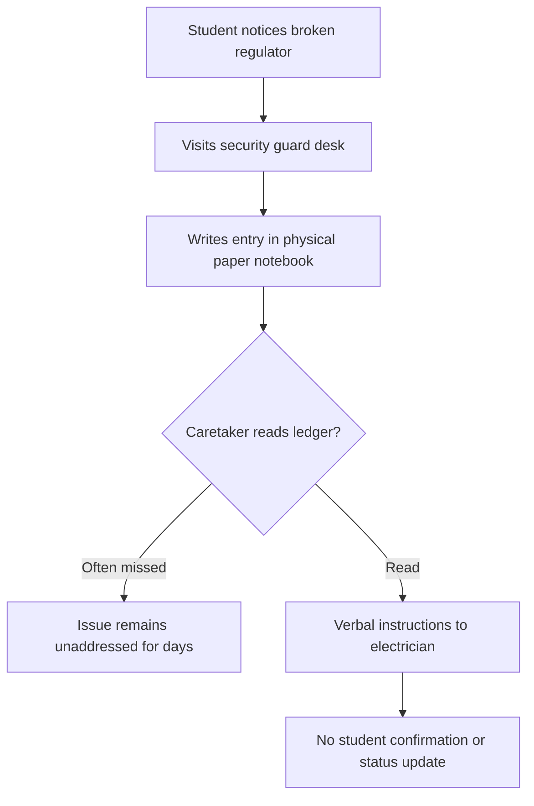
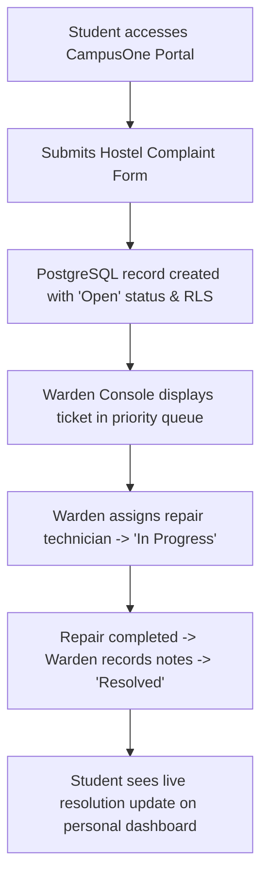

# Product Requirements Document (PRD)

## Feature: Integrated Hostel Maintenance & Campus Operations System

| Metadata             | Value                                           |
| :------------------- | :---------------------------------------------- |
| **Product**          | CampusOne (IIIT Ranchi)                         |
| **Document Version** | 1.1 (Production Baseline)                       |
| **Author**           | Rahul Kumar (Product Manager & Full-Stack Lead) |
| **Status**           | Implemented & Verified                          |
| **Target Launch**    | Spring 2025 Semester                            |

---

## 1. Problem Statement

At technical institutes such as IIIT Ranchi, hostel maintenance reporting is traditionally conducted via paper registers kept at security gates or ad-hoc messages to hostel caretakers. Consequently:

- Over 40% of maintenance requests suffer from missing location details (unclear room/wing).
- Students have zero visibility into whether an electrician or plumber has been dispatched, leading to duplicate complaints and student frustration.
- Wardens lack an auditable log of recurring infrastructure failures (e.g., repeating Wi-Fi switch failures in specific hostel wings).

---

## 2. Target Users

1. **Student Residents**: Undergraduate students residing across Hostel A, Hostel B, Hostel C, and Girls Hostel.
2. **Hostel Wardens & Caretakers**: Administrative personnel responsible for facilities, assigning work orders, and confirming repairs.

---

## 3. Current vs. Proposed Workflow

### Current Legacy Workflow

### Proposed CampusOne Digital Workflow

---

## 4. Goals and Non-Goals

### Goals

- **Eliminate Lost Requests**: 100% of submitted complaints captured with authenticated user IDs, timestamps, and room numbers.
- **Transparent Status Tracking**: Provide clear visual state progression: `Open` → `In Progress` → `Resolved` / `Rejected`.
- **Permission Enforcement**: Ensure students only inspect their own complaints while wardens inspect and manage the entire hostel queue.
- **Auditability**: Capture resolution notes or rejection rationales for every closed ticket.

### Non-Goals

- Real-time GPS tracking of repair technicians.
- Financial invoicing or payment processing for individual spare parts (managed under institute maintenance contracts).
- Automated hardware inventory restocking.

---

## 5. Functional Requirements

| ID        | Requirement Description                                                                                         | User Role      | Priority         |
| :-------- | :-------------------------------------------------------------------------------------------------------------- | :------------- | :--------------- |
| **FR-01** | Student can submit a maintenance request selecting Hostel Block, Room Number, Category, Title, and Description. | Student        | P0 (Must Have)   |
| **FR-02** | System enforces required fields and prevents empty or malformed submissions.                                    | All            | P0 (Must Have)   |
| **FR-03** | Student can view a real-time list of their own submitted tickets with visual status badges.                     | Student        | P0 (Must Have)   |
| **FR-04** | Student can withdraw/cancel their own complaint _only_ while status is 'Open'.                                  | Student        | P1 (Should Have) |
| **FR-05** | Authorized warden/admin can inspect complaints across all hostel blocks.                                        | Warden / Admin | P0 (Must Have)   |
| **FR-06** | Authorized warden/admin can update ticket status (`In Progress`, `Resolved`, `Rejected`).                       | Warden / Admin | P0 (Must Have)   |
| **FR-07** | System mandates a rejection reason if ticket status is changed to `Rejected`.                                   | Warden / Admin | P1 (Should Have) |
| **FR-08** | System records resolution notes when status is changed to `Resolved`.                                           | Warden / Admin | P1 (Should Have) |
| **FR-09** | Filter tickets by Status (`Open`, `In Progress`, `Resolved`, `Rejected`) and Category.                          | All            | P1 (Should Have) |

---

## 6. Non-Functional Requirements

- **Security & Authorization**: Row Level Security (RLS) strictly enforced at PostgreSQL level. Ordinary students must not be able to read peers' private room complaints or update ticket statuses.
- **Data Integrity**: Trigger-enforced `updated_at` timestamps on every state change.
- **Mobile Responsiveness**: Clean touch-friendly interface accessible on mobile viewports down to 360px.
- **Accessibility**: Semantic HTML form elements, color contrast meeting WCAG AA standards, and clear focus indicators.
- **Performance**: Sub-500ms query response time using indexed primary keys and user foreign keys.

---

## 7. User Stories & Acceptance Criteria

### User Story 1 (Student Submission)

> _As a hostel resident, I want to report a broken electrical fan online, so that maintenance staff are notified without me having to visit the guard desk physically._

**Acceptance Criteria:**

- Given I am logged in, when I navigate to `/institute-services/hostel-complaints` and click "Lodge Complaint",
- Then the modal opens with my name and email pre-filled.
- When I enter "Hostel B", "204", "Electrical", a summary, and description, and submit,
- Then the modal closes, a success toast displays, and my ticket appears with an `Open` badge.

### User Story 2 (Warden Status Update)

> _As a hostel warden, I want to mark an open repair request as "In Progress" and assign an electrician, so the resident knows work is underway._

**Acceptance Criteria:**

- Given I am authenticated as an administrator or faculty/warden,
- When I view the complaints queue, I see an "Update Status" action button.
- When I select "In Progress" and enter "Electrician Sharma",
- Then the database updates, the badge switches to blue `In Progress`, and the assigned technician name is displayed.

### User Story 3 (Security & Privilege Boundary)

> _As a student, I should not be able to alter my role or resolve my own complaints._

**Acceptance Criteria:**

- Given an authenticated student account,
- When the student inspects the UI, no "Update Status" button is available.
- When the student attempts a direct Supabase API update on status to 'Resolved',
- Then PostgreSQL RLS policy `Staff can update complaint status` rejects the update with error `new row violates row-level security policy`.

---

## 8. Edge Cases & Handling

1. **Roommate Duplicate Reporting**: If two roommates report the same corridor light failure, the warden can mark the second ticket as `Rejected` with note _"Duplicate of Ticket #104; combined under work order."_
2. **Student Withdraws While Technician is In Transit**: Once status advances from `Open` to `In Progress`, the "Withdraw Request" button is deactivated to prevent confusion.
3. **Network Failure on Submission**: The UI displays an explicit error toast and preserves form inputs so user does not lose typed text.

---

## 9. Rollout, Testing & Success Metrics

### Rollout Plan

- **Stage 1 (Internal Smoke Testing)**: Verification in local development environment against automated unit tests.
- **Stage 2 (Pilot Cohort)**: Deployed to Hostel B residents for 2 weeks to gather real maintenance cycle data.
- **Stage 3 (Campus-wide Rollout)**: Opened across all hostel blocks.

### Success Metrics

- **Mean Time to Acknowledge (MTTA)**: Time from `Open` to `In Progress` < 24 hours.
- **Mean Time to Resolution (MTTR)**: Time from `Open` to `Resolved` < 72 hours.
- **Ticket Re-opening / Dispute Rate**: < 5% of resolved tickets disputed.
